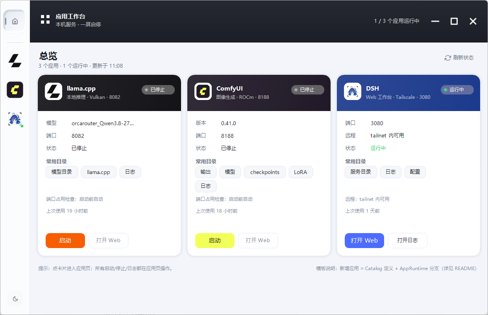
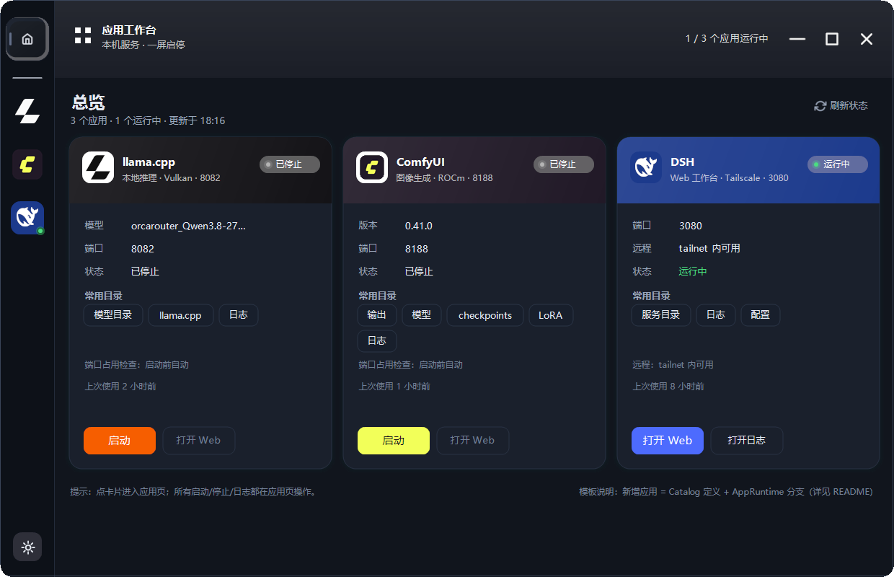
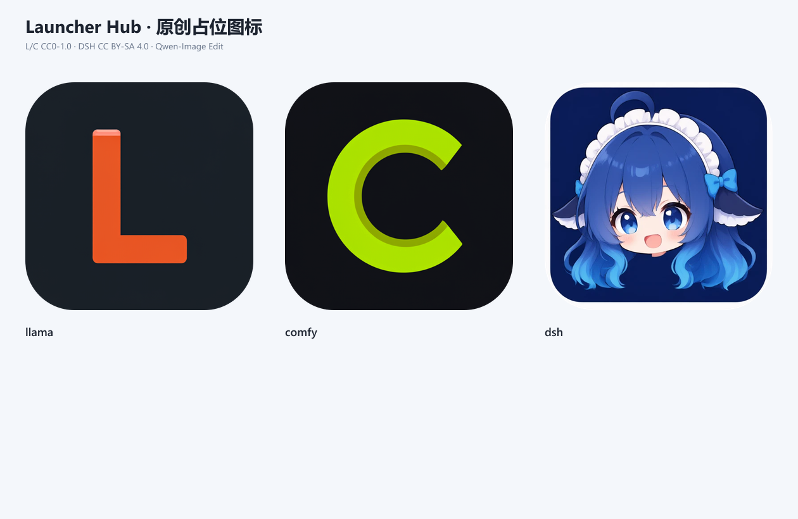

# 应用工作台（Launcher Hub）· v2.4

> 2026-10-25 建立并接线完成。把桌面上分散的 **llama.cpp / ComfyUI / DSH** 三个启动器合并成
> 一个壳、一个窗口、一套状态机；新增应用只改「应用清单 + 运行时分支」，不再重写界面。
>
> **官方品牌资产**（llama.brand / comfy.org / 官方 DSH 客户端）与 **useAnimations 动态图标**已接入；
> 单文件 exe：`.NET Framework 4.8 / WinForms / C# 5`，无第三方依赖。真实启停、健康探测、
> 日志 tail、配置读写、外部实例接管、托盘、单实例都已接通。

| 亮色总览 | 暗色总览 |
|---|---|
|  |  |

| llama.cpp | ComfyUI | DSH |
|---|---|---|
|  |  |  |

> 截图为 2026-10-25 实机状态：DSH 运行中，llama.cpp / ComfyUI 已停止；亮/暗主题均可切换并持久化。

## 1. 能做什么

| 能力 | 说明 |
|---|---|
| 统一壳 | 左侧应用栏切换「总览 / llama.cpp / ComfyUI / DSH」；banner 与内容作为一整块页签面板做 220 ms 过渡 |
| 品牌资产 | llama.cpp（官方 llama.brand）、Comfy（官方 comfy.org 品牌页）、DSH（官方 Web 客户端字标/鲸鱼）；来源/许可见 [assets/official/ATTRIBUTION.md](assets/official/ATTRIBUTION.md) |
| 动态图标 | 非品牌图标来自 useAnimations（MIT）：home / settings / file-text / refresh / maximize / play-pause / minus / moon；默认静态、悬停播放、播放/暂停随服务状态过渡 |
| 真实启停 | 启动幂等、启动前端口占用检查、停止杀进程树、重启、启动中/停止中状态锁 |
| 健康探测 | llama.cpp `/health` + `/props`；ComfyUI `/system_stats`；DSH 3080 TCP；每秒后台探测，线程池按应用并行，互不阻塞 |
| 外部实例 | 手工/旧启动器拉起的 llama-server、ComfyUI 也能识别并接管；停止时一并结束 |
| 日志 | 读取日志尾部，剥离 ANSI 颜色；llama 按 `时间/级别` 解析，ComfyUI 按 `[INFO]/[WARNING]/[ERROR]` 解析，DSH 按时间行解析 |
| 配置 | 首次启动自动从旧 `Llama-Launcher` / `ComfyUI-Launcher` 的 `config.ini` 迁移；之后使用新配置 |
| 常用参数 | llama 页内切换 gguf（自动排除 `mmproj-*`）、上下文、端口、自动开浏览器、mmproj；ComfyUI 额外参数/环境变量/安装路径/Python；DSH 远程入口 |
| 访问 | 打开 Web UI（未运行则先启动）、打开常用目录、打开配置/日志文件 |
| 窗口 | 1240×800 设计基准、响应式缩放、DWM 原生圆角/边框、拖动、最小化、关闭到托盘、单实例、窗口位置记忆 |
| 安全 | **DSH 不提供停止/重启**（Guardian 会拉起，且会中断当前会话）；退出工作台不会停止任何服务 |

## 2. 快速开始（干净 clone）

```powershell
git clone <this-repo> launcher-hub
cd launcher-hub
# 复制示例配置，按本机路径修改（config.local.json 已被 gitignore）
Copy-Item config.example.json config.local.json
notepad config.local.json

powershell -NoProfile -ExecutionPolicy Bypass -File .\build.ps1
.\LauncherHub.exe
```

没有 `config.local.json` 也能启动内置三应用：使用空路径，启动时会给出明确错误；agent/用户按 `docs/agent-guide.md` 适配。

> 官方图标和品牌资产按用户决定随仓库分发，但不属于 MIT 代码许可；见 [THIRD-PARTY-NOTICES.md](THIRD-PARTY-NOTICES.md)。

| 操作 | 效果 |
|---|---|
| 左侧应用栏 | 切换总览 / 三个应用页 |
| 应用页左下圆形按钮 | 启动 / 停止（DSH 运行中则是打开 Web） |
| 「重启」 | 停止后重新启动；DSH 为「打开日志」 |
| 主按钮 | 未运行 → 启动；运行中 → 打开 Web UI |
| 齿轮 | 不常用参数（只读为主，自动开浏览器可切换；打开配置/日志） |
| 日志右上 | 放大、打开日志文件 |
| 模型行 | llama 页点击弹出模型列表，选中即保存；运行中会按新模型自动重启 |
| 端口/上下文 | 点击进入内联编辑，Enter 保存、Esc 取消；运行中修改在重启后生效 |
| 顶部 — □ × | 最小化 / 最大化↔还原 / 关闭到托盘；拖动边缘可缩放，双击 banner 也可最大化 |
| 托盘 | 双击恢复；右键可显示、启动/停止、打开 Web、退出 |
| 主题按钮（左下） | 亮色 ↔ 暗色，写入 `theme.ini`；`Esc` 逐层关闭弹层 |

## 3. 三个应用

| 应用 | 启动方式 | 探测 | 卡片常驻 | 特殊 |
|---|---|---|---|---|
| llama.cpp | `<llama-root>\start-server.ps1`，环境变量 `LLAMA_PORT/MODEL/CTX/MMPROJ/EXTRA_ARGS` | `/health`；`/props` 取实际模型/ctx | 模型、上下文、端口、自动开浏览器、mmproj | 扫描 `<llama-models>\*.gguf`，排除 `mmproj-*` |
| ComfyUI | `<comfy-python> main.py --listen 127.0.0.1 --port …` | `/system_stats` 取版本/设备/显存 | 版本/设备/显存、端口、目录 | 输出重定向到 `comfyui.out.log` / `comfyui.err.log`；停止杀进程树 |
| DSH | `<dsh-dir>\dsh-launch.ps1 -NoOpen -Port 3080` | 3080 TCP | 端口、远程入口、目录 | 由 DSH-Guardian 守护；**只打开/启动，不停止/不重启** |

### 状态机

`已停止 → 启动中 → 运行中 → 停止中 → 已停止`；异常显示为「异常」并附错误原因。
启动超时：llama 240s、ComfyUI 180s、DSH 60s。启动中进程退出会立刻转异常并给出日志最后一条错误。

## 4. 配置

### 4.1 本机设置 `config.local.json`

`config.example.json` 是模板；复制成 `config.local.json`（已 gitignore）后填本机路径：

```json
{
  "appsDir": "apps",
  "remoteHost": "",
  "paths": {
    "llamaRoot": "<your llama.cpp>",
    "llamaScript": "<your start-server.ps1>",
    "llamaModels": "<your models>",
    "llamaLog": "<your server.log>",
    "comfyDir": "<your ComfyUI>",
    "comfyPython": "<your python.exe>",
    "dshDir": "<your DSH services>",
    "dshScript": "<your dsh-launch.ps1>",
    "dshLaunchLog": "<your dsh-launch.log>",
    "dshOutLog": "<your dsh-web.out.log>"
  }
}
```

### 4.2 应用清单 `apps/<id>/app.json`

有 `apps/` 时，运行时优先读取清单；没有时回退到内置三应用。示例见 `apps.example/` 和 `schemas/app.schema.json`。

- `launch`：`process` / `powershell` / `http`；
- `health`：`http` / `tcp` / `none`；
- `launch.stop`：`process-tree` / `none`；
- `icon.tile` / `icon.mark` / `icon.word`：1024 图标、512 mark、可选字标；
- `kind: generic` 会走通用启动/停止/探测路径，不需要改 C#。

### 4.3 运行时 INI

`%LOCALAPPDATA%\LauncherHub\` 仍保存 `llama.ini`、`comfy.ini`、`dsh.ini`、
`window.ini`、`theme.ini`（端口、模型、窗口位置、主题等）。清单里的 `port` 会覆盖
ini 的端口默认值。

## 5. 新增应用

### 5.1 配置式（推荐给 agent）

1. 复制 `apps.example/<id>/` 到 `apps/<id>/`；
2. 修改 `app.json` 的启动命令、工作目录、健康检查、端口、图标；
3. 运行 `tools/validate-apps.ps1`；
4. 启动 LauncherHub，应用会自动出现在 rail/首页。

通用应用只需要「启动一个进程 + 探测 HTTP/TCP + 读日志」，不需要改 `Data.cs`/`Backend.cs`。

### 5.2 代码模板式（复杂应用）

需要特殊状态、版本/显存解析、自定义界面时：

1. `src/Data.cs` 加 `Catalog` 工厂（品牌色、字标/图标、常用目录）；
2. `src/Backend.cs` 的 `AppRuntime` 加 `DoStart/DoStop/Probe*` 分支；
3. `HubController` 构造函数注册；
4. 资源放 `assets/`。

壳、状态机、日志解析、托盘、单实例、设置弹层、总览卡片都不用重写。

> `themes/*.json` 目前是目标契约，运行时仍读取 `Look.cs`；<br>
> 不要把它当成已生效的换肤配置。

## 6. 构建 / 预览 / 诊断

```powershell
# 编译（会覆盖 LauncherHub.exe；先关掉正在运行的实例）
powershell -NoProfile -ExecutionPolicy Bypass -File .\build.ps1

# 生成设计对比截图（2x；当前状态取自实时配置，预览不启动服务）
.\LauncherHub.exe --preview --scale=2

# 单张
.\LauncherHub.exe --out=preview\a.png --page=llama --scale=2

# 无界面自检：加载配置、探测三个应用，把 phase/端口/状态写到
# %LOCALAPPDATA%\LauncherHub\selftest.log
LauncherHub.exe --selftest

# 切换卡顿审计：真实窗体连续切 6 次页，输出每帧 gap/首帧/快照/render 到
# %LOCALAPPDATA%\LauncherHub\switch-audit.log；异常退出码非 0
LauncherHub.exe --audit-switch

# 动画覆盖审计：检查所有可点击图标是否都有 >1 帧的 sprite
LauncherHub.exe --audit-anim

# 布局/容器审计：1000/1240/1600/2560 窗口，检查卡片、按钮、说明、终端
# 是否越界/重叠；结果写 %LOCALAPPDATA%\LauncherHub\layout-audit.log
LauncherHub.exe --audit-layout

# 图标/贴图异常检测：离屏渲染首页，扫描 DSH 等深色图标底板边缘、
# 检查品牌 PNG 透明边界；结果写 %LOCALAPPDATA%\LauncherHub\icon-audit.log
LauncherHub.exe --audit-icons
```


## 7. 渲染、动画与图标检测（2026-10-25 修复）

### 7.1 渲染与动画

- **帧率**：UI 定时器从 33 ms（Windows 实际约 50 ms，20 fps）改为 **15 ms（Windows 实际约 16 ms，约 60 fps）**；
  页签/底板滑动 220 ms、内容淡出 180 ms，全部使用**时间基准 + easeOutCubic**，不再依赖“每 tick 固定步长”。
- **每帧成本**：卡片阴影/圆角/边框预渲染为缓存位图；启动时预热总览、三个应用页、设置弹层、日志放大层、每个应用的侧栏浮层。
  页面先画到一块 **32bpp RGB 离屏帧**，再以 1:1 `DrawImageUnscaled` 上屏；切换时快照直接 `Clone` 离屏帧（约 2 ms），旧页面用 **Win32 AlphaBlend** 做淡出，不再每帧用 GDI+ 逐像素 alpha 合成。
- **实测**：单帧 `Render` 约 **10–14 ms**，动画帧间隔 **15–18 ms**；页面切换不再出现 50–150 ms 的卡顿帧。
- **文字**：`TextRenderingHint.ClearTypeGridFit` + `TextContrast = 8`；物理帧渲染，逻辑坐标经 `RenderScale` 统一缩放；
  主字号从 8.25/9.75 pt 提到 **10/11 pt**，小字 7.5→8.75 pt，等宽 8.25→9.25 pt；同时加深 `Sub/Faint/TermDim` 对比度，
  并把原先带 alpha 的 banner/首页标题文字改为不透明合成色，避免 ClearType 在透明色上发虚。
- **动态图标**：官方 Lottie JSON 逐帧渲染为 64×64 白色 alpha sprite；运行时按文字色着色。默认静态，悬停播放一次；播放/暂停按服务状态正/反向过渡。窗口控制全部有动画：`minus` 来自 useAnimations，`max`/`restore`/`close` 是与现有线框风格一致的程序化 sprite（缩放/旋转/脉冲）。
- **主题**：底部按钮切换亮/暗；`Look.DarkTheme()` 只换色板不换字体；`theme.ini` 持久化。贴纸/手绘风格已移除。
- **DPI**：Per-Monitor V2；`RenderScale = DpiScale × WindowScale`，字体/几何/命中区域统一按逻辑坐标缩放。高 DPI 实机多屏仍需补测。

### 7.2 界面开发规范（必须遵守）

- **窗口外框采用 Edge 式 native frame + `WM_NCCALCSIZE`**：保留原生 `FormBorderStyle.Sizable`/`WS_THICKFRAME`，让 DWM 负责圆角、阴影、1px 边框、缩放和 Snap；只在 `WM_NCCALCSIZE` 中移除 caption 高度，把 banner/tab 画到窗口顶部。禁止再用 `Region` 或自绘圆角 pen 去裁外圈；若要求完全自绘的 1px 圆角边框，才需要整体改 layered window（per-pixel alpha）。
- 最小化/最大化/关闭是自绘按钮；最大化必须真正改变窗口 Bounds 并重排 `Geo`，不能只弹提示。
- **选中页签用简化新拟态**：单一路径，左圆角、右方角，右缘停在 rail 右边框；fill=`TabBase`（比 rail 暗 5.5% Ink）；缓存深色内阴影（左上）+ 底部高光。页签与卡片之间保留页面底色，不填 strip、不做 bridge/凹口；卡片保持独立圆角。
- **窗口控制图标必须画进正方形 dest**：44×30 是按钮热区，不是 sprite 画布；禁止把 64×64 sprite 拉伸到 44×30，否则图标会压扁。审计会检查 dest aspect。
- 新增布局使用 `Geo.Resize` 的字段（Content/Left/Right/Term），不要写死 1240×800 坐标。
- 主题只保留亮/暗两套扁平色板；贴纸/手绘风格不再提供入口。
- **所有可点击图标必须有动画覆盖**：窗口控制（min/max/restore/close）、首页/刷新/日志/设置/展开/主题/播放暂停都必须在 `AnimationAudit` 的预期表里，并且有 >1 帧 sprite；`--audit-anim` 缺失即 FAIL。

### 7.3 图标检测机制

`LauncherHub.exe --audit-icons` 会离屏渲染首页并做规则检查：

- 深色鲸鱼底板（DSH）的**圆角内侧 4px 边缘带**不得出现比品牌色明显更亮的像素；这能抓到本轮「白底 + 品牌色两次 FillRound」产生的白色描边。
- 品牌 PNG 检查透明边界：字标/图标四边不透明比例超阈值即报警（`comfy_mark` 这类自带方底的图标单独处理）。
- 结果写 `%LOCALAPPDATA%\LauncherHub\icon-audit.log`，退出码非 0 表示有异常；新增应用时把它的 tile 区域加入 `IconAudit` 的区域表即可。
- 实测：修复前 DSH 首页 tile 边缘检出 18 个亮像素、侧栏 tile 22 个；修复后 PASS。

### 7.4 切换卡顿检测

`LauncherHub.exe --audit-switch` 会启动真实窗体，按 `home→DSH→llama→ComfyUI→DSH→llama→ComfyUI` 连续切换，测量：

- 输入→切页、快照耗时、首帧耗时；
- 切换动画期间的最大帧间隔、Tick 间隔、单帧 Render 耗时；
- 每次都写 `%LOCALAPPDATA%\LauncherHub\switch-audit.log`，超过预算（首帧/帧间隔 >34ms、快照 >22ms、render >22ms）即 FAIL，进程退出码非 0。
- 正常运行时只在检测到 FAIL 时写 `switch-perf.log`，不产生常规磁盘 IO。

本轮它抓到并修掉两个真问题：

1. **动态图标的 `P.TintedFrame` 每帧都做 ColorMatrix**：7 个图标 × 约 5ms = 35ms/帧。改为按图标/颜色缓存整张 tinted sprite sheet，之后只做普通 `DrawImage`；单帧 44ms → **4.4ms**。
2. **UI 线程调用 `SyncAll` 会等后台 WMI/HTTP 探测锁**，偶发 85–100ms Tick 卡顿。改为 monitor 线程同步，UI 不再等待探测锁；Warmup 后主动 GC 一次。

当前审计结果：首帧 2–3ms、帧间隔 17–21ms、render 11–13ms、快照 2–3ms，**PASS**；日志见 `docs/switch-audit-2026-10-25.log`。

### 7.5 动画覆盖检测

`LauncherHub.exe --audit-anim` 专门回答「哪些可点击图标还缺动画」：

- 维护一份角色 → sprite 的预期表：`window-min→minus`、`window-max→max`、`window-restore→restore`、`window-close→close`、`home`、`refresh`、`log`、`settings`、`expand`、`theme`、`play/pause`；
- 每个条目必须同时有 manifest 条目、PNG、帧数 >1；还必须在真实布局里**实际调用到 `AnimIcon`**：审计会离屏渲染普通首页、应用页、最大化首页，检查每个角色是否真的走动画管线。只检查资产存在、按钮却仍用静态 `P.Icon` 的「假覆盖」也会 FAIL。
- 同时检查每个 icon 的绘制 dest 是否为正方形（>±5% 即 FAIL），防止 64×64 sprite 被压进 44×30 按钮。
- 结果写 `%LOCALAPPDATA%\LauncherHub\anim-audit.log`，归档 `docs/anim-audit-2026-10-25.log`；缺失时退出码非 0。
- 当前窗口控制的实现：`minus` 来自 useAnimations；`max`/`restore`/`close` 为同线框风格的程序化 sprite（缩放/旋转/脉冲），避免 useAnimations 里形状不匹配的 `x-square`/`maximize-minimize`。
- 新增可点击图标时，先在 `AnimationAudit.Expected` 登记角色和 sprite，再跑审计；这样不会出现「缩小有、放大/关闭漏了」这种只靠肉眼发现的问题。

### 7.6 响应式与 DPI（基础能力）

三个维度必须分开，不能混成一个“缩放”：

```text
DPI 缩放 = deviceDpi / 96
窗口缩放 = clamp(min((clientW / DpiScale) / 1240, (clientH / DpiScale) / 800), 0.78, 1.25)
RenderScale = DPI 缩放 × 窗口缩放
```

- 进程使用 **Per-Monitor V2**（失败回退 System DPI Aware）；
- `RenderScale` 同时作用于字体、图标、间距、圆角、按钮；布局在**逻辑坐标**里重排；
- 渲染在物理像素帧上做 `ScaleTransform`，不缩放最终位图，避免文字发糊；
- 鼠标/命中测试经 `ToLogical` 换算；内联编辑框经 `ToPhysical` 换算；
- 内容平面最大宽度 1380，超宽时居中，不无限拉卡片；
- 小窗口允许缩到 0.78，优先保证不裁切，而不是硬塞固定字号；
- 窗口最小尺寸按 DPI/缩放换算，不能写死物理像素；
- `WM_DPICHANGED` 时重新算缩放并重排。

**响应式规则**：

- 布局宽度按窗口实际逻辑宽度重排；字号/控件按 `RenderScale`；
- 内容区有最大宽度；大窗不把卡片拉到 2000px；
- 不用“整体等比画布 + 留黑边”冒充响应式；
- 1px 边框由 DWM 负责，不参与 GDI+ 缩放。

**测试矩阵**：100/125/150% DPI；1000×700、1240×800、1600×1000、2560×1392；最大化/还原；多屏拖动（高 DPI 实机待补测）。`--audit-layout` 会按矩阵检查卡片/按钮/说明/终端越界与重叠，异常退出码非 0。

本次开发经验已固化为项目内 skill：[skills/windows-desktop-gdi-launcher/SKILL.md](skills/windows-desktop-gdi-launcher/SKILL.md)。缩放四档对比与重叠验证见 [验收报告-缩放-2026-10-26.md](docs/验收报告-缩放-2026-10-26.md)。

容器查询思路与防重叠清单见 [skills/responsive-container-audit/SKILL.md](skills/responsive-container-audit/SKILL.md)。

调研结论：[UI/美学 skill](docs/调研-UI-skill-2026-10-26.md)、[桌面工程 skill](docs/调研-桌面-skill-2026-10-26.md)。

### 7.7 Agent 模板：占位图标与 App Schema

本项目按“给 agent 改造的启动器框架”组织，而不是绑定三个应用的成品。



- 占位图标：`assets/placeholders/`，CC0-1.0，原创设计 + Qwen-Image 生成；
- 图标设计：`L` / `C` / 鲸鱼娘头像，保留原配色与语义，不复刻官方轮廓；
- App Schema：`schemas/app.schema.json`；
- 示例应用：`apps.example/llama|comfy|dsh/app.json`；
- 校验：`powershell -NoProfile -ExecutionPolicy Bypass -File tools/validate-apps.ps1`；
- Agent 操作手册：`docs/agent-guide.md`；
- 品牌/视频边界：`docs/资产与品牌政策.md`。

当前页面按用户决定：**llama / ComfyUI 使用官方图标，DSH 使用鲸鱼娘头像**。官方图标已纳入仓库；这会有品牌授权风险，授权边界见 `docs/资产与品牌政策.md`。`assets/placeholders/` 的 L/C 占位保留给想替换官方方图标的 agent。

## 8. 经验记录

开发过程、根因、失败尝试与下次检查清单见 [docs/开发经验-通用启动器.md](docs/开发经验-通用启动器.md)。

## 9. License / assets

- **代码**：MIT，见 [LICENSE](LICENSE)。
- **官方品牌图标/字标**：不属于 MIT；按用户决定随仓库分发，授权链与风险见 [THIRD-PARTY-NOTICES.md](THIRD-PARTY-NOTICES.md)。
- **DSH 鲸鱼娘头像**：社区参考图编辑的非官方占位，CC BY-SA 4.0 标注，参考图本身不入库。
- **useAnimations 动态图标**：MIT，保留 `assets/anim/ATTRIBUTION.md`。
- 本项目不隶属于 llama.cpp / ComfyUI / DeepSeek，也不代表官方背书。
## 10. 已知限制

- 默认窗口 1240×800；最大化/还原和边缘拖拽缩放已接通，布局按宽度/高度重排（左侧栏固定，卡片/终端扩展）。最大化时内容按逻辑坐标重排/缩放，避免把卡片拉到 2000px；高 DPI 实机多屏仍需补测。
- 外框是 **native frame + `WM_NCCALCSIZE`**：DWM 画圆角/阴影/边框，应用把 caption 高度并入客户区。若要完全自绘的 1px 圆角边框，仍需 layered window，见开发经验 §2.7。
- `kind: generic` 可配置式新增应用；需要特殊版本/显存解析或自定义界面的应用仍需改 C#（见 §5）。
- 关闭到托盘后仍每秒探测；退出工作台不会停止服务，服务继续由各自脚本/Guardian 管理。托盘未做「异常主动提醒」，异常状态需打开窗口查看。
- 贴纸/手绘风格已从界面和代码入口移除，只保留亮/暗两套扁平主题。

## 11. 文件

```
launcher-hub\
  LauncherHub.exe        构建产物（gitignore）
  src\                   Program / HubForm / Renderer / Paint / Look / Data / Backend / Config / audits
  assets\                官方品牌 PNG + 占位图标 + useAnimations
  assets\official\       官方 SVG、许可与署名
  assets\anim\           useAnimations sprite sheet + manifest
  assets\placeholders\   原创占位图标、提示词、生成脚本
  apps.example\          可复制的应用清单
  schemas\               app/theme schema
  themes\                设计 token（目标契约）
  docs\agent-guide.md    agent 操作手册
  docs\资产与品牌政策.md  品牌/视频边界
  docs\验收报告-缩放-2026-10-26.md  缩放验收
  design\concept.png     原始手绘设计稿
  preview\               实机截图
  config.example.json    本机路径/远程入口模板
  build.ps1              csc.exe 编译
  tools\                 manifest/secret/audit helpers
  .github\               CI 与 issue/PR 模板
```

## 12. 2026-10-25 接线验证

- ComfyUI：从工作台启动（8188 健康、状态行版本/设备/显存正确）→ 停止（端口关闭、python 进程树清理）。
- llama.cpp：启动配置中的本地模型（加载期间显示启动中/503 容忍）→ `/health` 200 转运行中 → 停止（端口关闭）。
- DSH：3080 运行中被正确识别为运行中；只验证打开入口与状态，**未停止/未重启**。
- 配置迁移、模型下拉切换、上下文内联编辑、自动开浏览器开关、设置弹层、关闭到托盘、单实例恢复均实测。
- 动画/文字：15 ms 定时器 + 时间基准缓动；实测单帧 Render 10–14 ms、动画帧间隔 15–18 ms；ClearType + 1:1 离屏帧 + 字号/对比度提升，修复后截图见 `preview/`。
- 品牌/动态图标：官方 llama.brand / comfy.org / DSH 侧栏字标；useAnimations sprite 已接入 home / settings / file-text / refresh / maximize / play-pause / minus / moon。
- 窗口：右上角 □ 测试最大化→还原；双击 banner 最大化；拖底边/侧边测试缩放（最小 1000×700）；1px 窗口边框亮/暗主题均可见。
- 主题：左下按钮亮↔暗切换并重启验证 `theme.ini` 持久化；DSH 深色 tile、llama 白色图标在暗色下对比正常。
- 贴纸风格：F2/风格 B 已移除，`--preview` 不再生成 sketch 截图。
